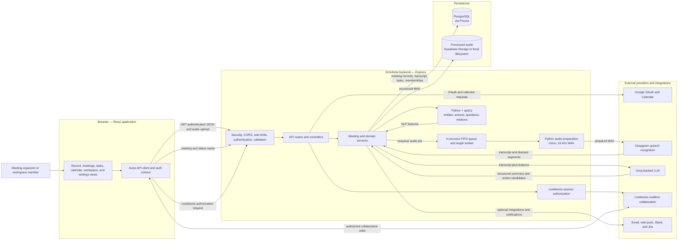
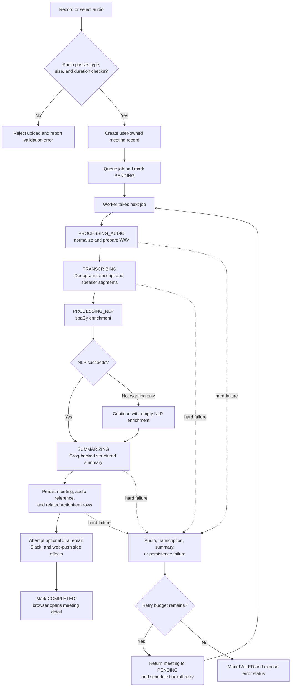

# EchoNote

**EchoNote is an AI meeting-intelligence application that turns audio into searchable, speaker-attributed transcripts, structured summaries, and follow-up work.** This document describes the checked-in product architecture and traces one illustrative meeting through it.

## Product problem

Meeting decisions are easy to lose between spoken discussion, personal notes, and task trackers. EchoNote keeps the recording, transcript, summary, decisions, and extracted action items connected to one meeting record. A user can revisit that record, refine meeting content, follow action items, share a summary, or bring the meeting into a workspace.

The application has two main runtimes:

- **Frontend:** React 18 single-page application with protected meeting, task, calendar, analytics, and workspace views.
- **Backend:** Express API and a background meeting worker. Prisma persists structured product data in PostgreSQL; audio processing and AI enrichment are composed from local Python tools and external services.

## Case study: turning a planning conversation into follow-through

This is an **illustrative scenario**, not a report of a real customer meeting or a measured result. It follows the implementation's actual interfaces and processing stages.

### Situation

A product team finishes a planning discussion with decisions and ownership expressed in conversation. The organizer needs more than an audio file: they need to locate what was said, distinguish speakers, capture the agreed work, and make the result reviewable by the team.

### Trace through EchoNote

1. **Capture the source.** The organizer records in the browser or selects a supported audio file. Browser recording uses the microphone through `getUserMedia` and RecordRTC; the recording hook requests mono audio and applies browser echo-cancellation, noise-suppression, and gain-control constraints. The record screen collects a title and category, with an optional description. Client-created recordings are capped at ten minutes.
2. **Admit and identify the meeting.** The frontend submits the meeting metadata and audio to the authenticated meeting-upload API. The backend applies upload rate limiting, checks the file type and extension, size, and duration, creates a meeting owned by the authenticated user, and places the audio job on the processing queue. A new meeting begins as `UPLOADING`; queue admission changes it to `PENDING`. The upload response gives the browser the meeting ID before analysis finishes.
3. **Prepare audio for speech recognition.** A worker takes the next queued job and marks it `PROCESSING_AUDIO`. The Python audio processor loads mono audio, resamples it to 16 kHz when needed, lightly normalizes peaks, trims silence, and writes 16-bit PCM WAV. This gives the transcription service a consistent input format.
4. **Build the transcript.** The meeting advances to `TRANSCRIBING`. Deepgram receives the prepared audio with punctuation, paragraph, utterance, diarization, entity, topic, and intent options enabled. The result includes transcript text, timestamped speaker segments, confidence information, and provider-extracted signals. The service retries retryable provider failures up to three times within a transcription call.
5. **Enrich the discussion.** The meeting advances to `PROCESSING_NLP`. A Python subprocess runs spaCy's `en_core_web_lg` model against the speaker-labelled transcript. It extracts and deduplicates entities, subject–verb–object triplets, action-language signals, questions, and a speaker-to-entity map. These are supporting signals, not verified meeting facts.
6. **Generate reviewable outputs.** The meeting advances to `SUMMARIZING`. The transcript and available NLP/Deepgram features are sent to the configured Groq-backed language-model service. The structured result can include an executive summary, key decisions, action items, next steps, topics, and sentiment. A transcript longer than 200 characters is eligible for the service's verification/correction pass.
7. **Persist the meeting as a connected record.** PostgreSQL stores the transcript, segments, confidence, NLP fields, summary, processing timestamps, and status on the `Meeting`. Each generated action item is also stored as an `ActionItem` with an initial `TODO` status and a link to its meeting and owner. The processed WAV is stored in Supabase Storage when configured; otherwise it is copied to local audio storage.
8. **Route follow-through.** When configured, action items can be synchronized to Jira. Completion notifications are attempted through email and web push, and through a user's Slack webhook when present. These notifications are best-effort side effects: their failures are logged without undoing a completed meeting. The browser polls the meeting-status endpoint every three seconds and opens the completed meeting detail when processing reaches `COMPLETED`.
9. **Review and collaborate.** The organizer can revisit the transcript and generated summary, manage the resulting work through the task surface, and share the meeting or add it to a workspace. Liveblocks access is authorized by the backend against meeting ownership or workspace membership and role; workspace owners/editors receive edit access while viewers receive read access.

For example, an illustrative utterance such as “I will send the rollout checklist by Thursday” remains part of the speaker-labelled transcript and is passed, with extracted signals, to summary generation. A resulting action item is a model-generated candidate for a person to review—not a guarantee that the statement, owner, or deadline was interpreted correctly.

### What the case demonstrates

EchoNote's key product decision is to make the meeting the durable unit of context. The audio, transcript, summary, action items, sharing state, and workspace association remain linked rather than being emitted as unrelated artifacts. The pipeline also exposes status transitions to the browser, so asynchronous work can be followed without holding the upload request open.

## Architecture



### Request and processing boundaries

- **Synchronous API boundary:** Express authenticates and validates requests, creates the meeting record, and accepts the queued upload. The browser then reads processing status separately.
- **Processing boundary:** A backend-local FIFO queue invokes the meeting service, which coordinates audio preparation, Deepgram transcription, Python NLP, LLM summarization, persistence, and side effects.
- **Structured-data boundary:** Prisma maps users, meetings, workspaces, action items, and related state to PostgreSQL.
- **Audio boundary:** Source uploads and intermediate files use the backend filesystem. On successful processing, the normalized audio is copied to Supabase Storage when configured, with a local filesystem fallback.
- **Collaboration boundary:** The backend grants Liveblocks access only after checking the authenticated user's meeting ownership or workspace membership and role. Collaborative editing traffic then flows between the browser and Liveblocks.

## Meeting processing lifecycle



The status API reports stage names, progress values, timestamps, and processing errors. Progress percentages and remaining-time values are stage-based estimates, not measurements of the work remaining for a particular recording. NLP failure is explicitly non-fatal to summary generation; audio preparation, transcription, summary, or persistence failures enter the queue's retry/failure path.

## Product capabilities

- **Identity and access:** Google sign-in with backend-issued JWT access and refresh tokens; protected API resources are scoped to the authenticated user.
- **Meeting capture and library:** Microphone recording, supported audio-file upload, meeting categories, meeting search/filtering, and per-meeting status.
- **Meeting intelligence:** Speaker-labelled transcript segments, editable speaker mapping, summary and decision views, follow-up generation, and meeting analytics.
- **Action tracking:** Generated action items become user-owned records with `TODO`, `IN_PROGRESS`, or `DONE` status; the UI includes task and decision surfaces.
- **Calendar:** Google Calendar event retrieval and meeting metadata association.
- **Sharing and collaboration:** Public meeting-summary links, workspace membership roles (`OWNER`, `EDITOR`, `VIEWER`), workspace meetings, and Liveblocks-backed collaboration.
- **Connected workflows:** Optional Jira issue creation/sync, Slack notifications, completion email, and web-push notifications.
- **Account controls:** Profile and notification settings, session/token operations, and audio-retention fields are represented in the backend model.

## Data model

| Record | Purpose in the product |
|---|---|
| `User` | Identity, Google tokens, notification/integration preferences, and ownership relationships. |
| `Meeting` | Meeting metadata, processing state, audio reference, transcript, NLP fields, summary, sharing state, retention timestamps, and owner. |
| `ActionItem` | A task linked to both its meeting and user, with assignee, deadline, priority, confidence, source quote, status, and optional Jira identifiers. |
| `Workspace` / `WorkspaceMember` | Team container and membership/role assignments. |
| `WorkspaceMeeting` | Associates a meeting with a workspace. |
| `ProcessingLog` / `UserActivity` | Schema support for processing and user-activity records. |
| `PushSubscription` | Per-user web-push endpoint and subscription keys. |

The canonical schema is `backend/prisma/schema.prisma`. Transcript segments, attendees, summary action-item snapshots, and key topics use JSON fields where modeled; the primary searchable meeting and user records are relational.

## Technology and integrations

| Area | Implementation |
|---|---|
| Web client | React 18, React Router, Axios, HeroUI, Tailwind CSS, RecordRTC |
| API | Node.js, Express, JWT authentication, validation/rate-limit/security middleware |
| Data access | Prisma ORM with PostgreSQL |
| Audio preparation | Python, librosa, NumPy, SciPy, soundfile; FFmpeg/FFprobe are used for audio metadata and validation paths |
| Speech recognition | Deepgram SDK; Nova-3 is the default transcription model in the service |
| Local language analysis | spaCy `en_core_web_lg` via a Python subprocess |
| Summaries and follow-ups | Groq SDK through the custom LLM service; default summary model label is `llama-3.3-70b-versatile` |
| Audio persistence | Supabase Storage when configured, otherwise local backend storage |
| Realtime collaboration | Liveblocks client and server authorization |
| Product integrations | Google OAuth/Calendar, Jira, Slack webhooks, email, and Web Push |

The AI services are external dependencies for their respective steps: transcription requires Deepgram, and summary generation requires the configured LLM service. The NLP analysis runs through the backend's Python environment.

## Reliability, privacy, and operational boundaries

- The queue is an **in-memory, single-process FIFO**. It processes one job at a time and checks for work every five seconds. Meeting status is persisted, but queued audio-file job payloads and retry timers are not stored in a durable broker. A backend restart can therefore leave a `PENDING` meeting without its in-memory job; the current startup path does not reconstruct queued jobs from PostgreSQL. This design is not a durable or horizontally scaled worker architecture.
- Queue-level retry scheduling uses exponential delays based on the persisted retry count: up to three scheduled retries at 60, 120, and 240 seconds, then `FAILED`. The client can surface that error from the status response.
- Scheduled housekeeping removes old temporary/processed audio files hourly; a separate five-minute job probes PostgreSQL connectivity.
- NLP errors are logged and converted to empty enrichment so summarization can still run. This does not mean generated summaries or action items are verified facts; meeting owners should review them.
- Audio is sent to Deepgram for transcription, and transcript plus NLP features are sent to the configured language-model provider for summary generation. Organizations should account for those provider boundaries when processing sensitive conversations.
- Supabase audio uploads currently store the provider's public URL as the meeting audio reference. Otherwise, audio resides on the backend filesystem. Actual access and durability depend on storage configuration and deployment; the repository does not establish a universal private-storage or backup guarantee.
- The backend uses Helmet, configured CORS, API/upload/search rate limits, authentication, validation, and ownership checks. Liveblocks grants are separately restricted by meeting ownership or workspace role. These controls do not constitute a compliance certification.
- Recording and upload duration/file-size limits are enforced at the client and backend boundaries; backend defaults are configurable. Capacity planning must account for Python audio work, external AI latency, and the single-worker queue.

## Repository map

```text
frontend/
  src/pages/                 Product screens, including recording and meeting detail
  src/services/              API, meeting, auth, task, storage, and notification clients
  src/contexts/ and hooks/   Authentication, meeting state, recorder lifecycle
  src/components/            Meeting, workspace, dashboard, and common UI
backend/
  src/routes/                HTTP route registration
  src/middleware/            Authentication, upload, validation, rate limits, errors
  src/controllers/           HTTP request handlers
  src/services/              Meeting orchestration and provider/domain services
  src/python_scripts/        Audio and transcript analysis programs
  src/config/                Database and integration configuration
  prisma/schema.prisma       PostgreSQL data model
.readme                      This architecture and case-study document
```

The root package coordinates the frontend and backend development processes and exposes lint/format scripts. Backend package metadata includes Jest and Supertest; the frontend uses the Create React App test runner.
